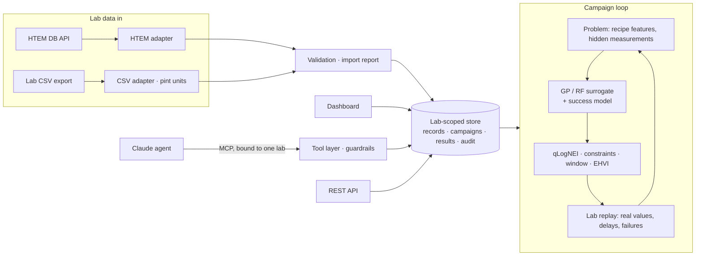

# Lodestone

**An AI loop that helps a materials lab choose its next experiment, and shows on the lab's own past data how many experiments it would have saved.**

Lodestone takes a lab's experimental records, cleans them into one format with units and provenance, and runs a Bayesian-optimization loop that picks the next samples to make. It is demonstrated here on real thin-film data from NREL's public [High-Throughput Experimental Materials Database](https://htem.nlr.gov) (HTEM DB).

> **How the demo works.** The "lab" is a **replay** of HTEM DB. When the optimizer picks a sample, it gets back that sample's real past measurement, so every number can be checked against the source. The limit: the loop can only choose among samples that were actually made. No new experiments were run and no new material is claimed.


## Who it's for

- **Thin-film and materials R&D labs** that make dozens of samples to find a few good ones, and want to know whether a model would have found them sooner. The replay answers that on your own history before you change anything in the lab.
- **Teams building self-driving or closed-loop labs** who need the unglamorous parts done properly: lab-data connectors, unit handling, failed measurements, and keeping each lab's data separate.
- **Anyone evaluating Bayesian optimization honestly.** Every result is compared with random and grid search on the same budget and seeds, and the weak results are reported too.

## Key takeaways

On four campaigns over real HTEM data (20 seeds each), the number of experiments needed to find 5 of the top-5% samples was:

| Campaign (real HTEM data) | Random | Grid sweep | **Bayesian (GP)** |
|---|---|---|---|
| Most conductive zinc tin nitride (999 samples) | 61 (6/20 got there) | 61 (3/20) | **39 (19/20)** |
| Transparent p-type conductor, gap ≥ 3 eV (880 samples) | 61 (3/20) | 56 (11/20) | **31 (18/20)** |
| Band gap in the 1.4–1.6 eV window (999 samples) | 61 (5/20) | 61 (3/20) | **50 (16/20)** |
| Most conductive IZTO (176 samples, budget 40) | 41 (0/20) | 41 (0/20) | **32 (16/20)** |

"61" means most runs didn't get there within the 60-experiment budget.

- **The optimizer finds 2.5–4× as many top-5% samples** as random or grid search on the same budget. The gain holds at 0–20% lab failure rates and at batch sizes of 1, 5 and 10.
- **Counted in deposition runs, the savings shrink.** When one experiment is a whole library (~44 spots made in one run; 10-run budget, 20 seeds), every method finds its first top-5% sample within 2–4 runs, and the optimizer finds 1.4–1.6× as many top-5% samples as random, not 2.5–4×. The ratio depends on the budget: 1.7–1.9× at 5 runs, 1.2× at 15. IZTO has only 4 libraries, too few to test.
- **Finding many good samples is not the same as finding the single best one.** On the transparent-conductor campaign, the optimizer's median *best* value is no higher than random's.
- **Pick a metric that can lose.** "Experiments to the *first* top-5% sample" doesn't separate the methods, because the 10 random starting experiments often get lucky.
- **Honest error bars didn't help the optimizer.** The model's 68% intervals contain the real value only 43–61% of the time. Widening them to the right size made the loop find *fewer* good samples, so the optimizer keeps the narrow ones. The error bars shown to people are widened to the calibrated size.
- **Real lab data is messy, and handling that openly is most of the work.** 365 HTEM zinc tin nitride samples have no composition, and some libraries are listed but serve no samples. These are rejected with a reason, not guessed.

Every number, with robustness runs, data-import results and the agent evaluation, is in **[reports/EVALUATION.md](reports/EVALUATION.md)**.


## How it works

1. **Data in.** A connector pulls sample libraries (the HTEM API here, or another lab's CSV export). Every record becomes one standard format with explicit units and provenance back to the source sample, or is rejected with a reason.
2. **A goal in plain English.** "Transparent conductor: maximize conductivity with band gap above 3 eV" becomes a validated campaign spec that you confirm.
3. **The loop.** Each round, a Gaussian-process model (BoTorch) picks a batch of samples, each with a one-line "why this sample". It supports a single objective, constraints, a target window, or two objectives.
4. **Failures teach the model.** A missing conductivity reading usually means the film was too resistive to measure, so it counts as a low value rather than being dropped. A second model learns where measurements tend to fail.
5. **Proof it helps.** The same goal and budget are replayed with random and grid search, and the experiments saved are converted to cost.
6. **Private workspaces.** Each lab's data, campaigns and results live in its own workspace. Isolation is enforced in one place and attacked by automated tests.



The model sees only what a lab controls: cation composition, deposition temperature and pressure, and film thickness. Measurements stay hidden until the replay "runs" a sample.

## Try it

You need [uv](https://docs.astral.sh/uv/) and Python 3.11+. A snapshot of the three demo systems' HTEM data ships in `data/htem/` (about 125 KB), so no network or API key is needed.

```bash
git clone https://github.com/anushajain2/lodestone.git
```

```bash
cd lodestone
```

```bash
uv sync
```

```bash
uv run lodestone seed
```

```bash
uv run lodestone dashboard
```

Then open http://localhost:8501. `seed` creates two demo labs:

- **Northwind Thin Films:** zinc tin nitride and indium zinc tin oxide from HTEM, with a finished conductivity campaign and a band-gap-window campaign in progress.
- **Helix Materials Lab:** cobalt nickel zinc oxide arriving from two sources (the HTEM connector, plus a CSV export in another format with a few broken rows), with a transparent-conductor campaign.

Use the sidebar to switch labs: neither can see the other's data.

To run a campaign from the command line instead:

```bash
uv run lodestone campaign run "most conductive zinc tin nitride, 40 experiments"
```

## Use it on your own data

**Import a lab's CSV export** into a workspace. Put units in the column headers (`Substrate T [K]`, `Rho [mOhm*cm]`, `Thickness [nm]`); they are converted with `pint`, and rows with missing or impossible values are rejected with a reason. [`data/partner_lab/helix_second_lab_export.csv`](data/partner_lab/helix_second_lab_export.csv) shows the expected columns.

```bash
uv run lodestone data import --partner partner-a --system Co-Ni-O-Zn --csv path/to/export.csv
```

**Pull any public HTEM system** from the live API, then import it:

```bash
uv run lodestone data pull --system In-O-Sn-Zn
```

```bash
uv run lodestone data import --partner partner-a --system In-O-Sn-Zn
```

**Replay your goal against baselines.** Compare a campaign with random and grid search over several seeds:

```bash
uv run lodestone campaign compare <campaign-id> --seeds 5
```

**Serve the REST API** at http://127.0.0.1:8000/docs (header `X-API-Key: demo-token-a` or `demo-token-b`):

```bash
uv run lodestone api
```

**Let Claude run campaigns.** The MCP server exposes the same tools to any MCP client, bound to one lab:

```json
{
  "mcpServers": {
    "lodestone": {
      "command": "uv",
      "args": ["--directory", "/path/to/lodestone", "run", "lodestone", "mcp"],
      "env": { "LODESTONE_PARTNER_TOKEN": "demo-token-a" }
    }
  }
}
```

Or run the built-in agent: `ANTHROPIC_API_KEY=... uv run lodestone agent run`.

**Reproduce the evaluation.** `uv run lodestone bench` reruns the benchmark, `uv run lodestone eval calibration` the uncertainty check, and `uv run lodestone eval report` rewrites `reports/EVALUATION.md`. `uv run pytest` runs the tests, including the cross-lab isolation attacks.

## Repository map

```
src/lodestone/
  schemas.py              records, import reports, campaign specs (units, provenance)
  connectors/htem.py      HTEM DB API connector + snapshot
  connectors/adapters.py  HTEM and lab-CSV adapters, validation
  onboarding.py           import into a lab workspace
  goals.py                plain-English goal reader
  loop/                   problem, models (GP/RF, censoring, success model, calibration), selection, replay, benchmark
  campaign.py             campaigns as a lab-scoped service (rounds, status, explain, compare, recipes)
  store.py                lab-scoped SQLite store and audit log
  tools.py, mcp_server.py, agent.py   MCP tools, server, Claude agent and a scripted reference policy
  api.py, export.py, report.py, demo.py, cli.py
  evals/                  agent tasks and scoring, onboarding and provenance checks
dashboard/app.py          Streamlit dashboard
tests/                    pytest
data/htem/                HTEM snapshot (3 systems); data/partner_lab/ a second lab's CSV
reports/                  benchmark, calibration, onboarding, agent eval, EVALUATION.md
legacy/dielectric/        an earlier version on computed dielectrics, kept for reference
```

## Limits

- The replay can only choose among samples that were made. The "suggest recipes" feature proposes new ones, but those predictions are unverified.
- The adapters have seen two data formats. A new lab's exports will need adapter work.
- The Claude agent's evaluation is built, but so far only the scripted reference policy has been scored.

## Data and credits

- **HTEM DB:** A. Zakutayev et al., "An open experimental database for exploring inorganic materials", *Scientific Data* 5, 180053 (2018). Dataset DOI [10.7799/1407128](https://doi.org/10.7799/1407128). The data is public, but I couldn't find an explicit reuse license. **Check the terms with NREL/NLR before using it commercially.**
- NREL was renamed the National Laboratory of the Rockies in December 2025. The API now lives at `htem-api.nlr.gov`; the old `htem-api.nrel.gov` no longer resolves.
- Built with BoTorch, GPyTorch, scikit-learn, pint, FastAPI, Streamlit and the MCP Python SDK.
