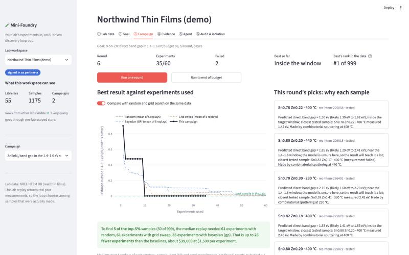
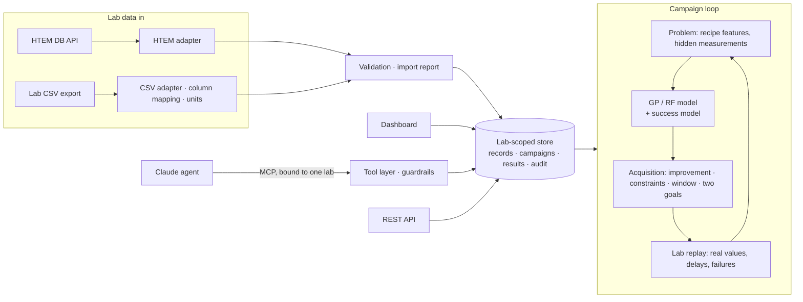

# Lodestone

**Lodestone helps a materials lab decide which sample to make next. First it checks, on the lab's own past experiments, whether letting a model choose would actually have saved experiments.**



## What it is

Many materials labs find good samples by trial and error. A thin-film group might make dozens of films, varying composition and deposition temperature, to find the few that conduct well or stay transparent. Each film costs time and money, and choosing the next one is mostly experience or a systematic sweep.

Lodestone does three things:

1. **Reads your experiment records.** It imports a lab's data (a CSV export, or NREL's public HTEM database), converts units, checks every row, and rejects bad rows with a reason instead of guessing.
2. **Learns from them and suggests what to make next.** You state a goal in plain English, such as "maximize conductivity with band gap above 3 eV". A statistical model learns how recipe relates to result and picks the next batch of samples, each with a one-line reason.
3. **Proves whether that helps, on your own history.** It replays your past experiments as if starting over. The model picks samples one batch at a time from what you actually made, and gets back the real measured result each time. It counts how many experiments it needed to reach your best samples, and compares that with random picks and a systematic sweep on the same budget.

The third step is the point. You see whether the model would have saved experiments in your lab before you change anything in it, and the answer can be "not proven".

> **About the demo data.** This repo is demonstrated on real thin-film measurements from NREL's public [High-Throughput Experimental Materials Database](https://htem.nlr.gov) (HTEM DB). No new experiments were run and no new material is claimed. Because it is a replay, the model can only choose among samples that were actually made.

## Who it's for

- **Thin-film materials labs with years of past experiments and no data-science team.** Run the replay on your own records and find out whether model-guided experiments would have reached your best samples sooner.
- **The scientist or engineer asked to "try AI" in that lab.** You get a working starting point instead of a research project: importers for messy exports, unit checks, failed measurements handled, a savings report to show your manager, and code small enough to read and adapt.
- **R&D managers deciding whether AI-guided experiments are worth paying for.** The report gives the saving in experiments and money, with a range, measured against the simple alternatives. It says "not proven" when the data doesn't support a saving.

Today it handles composition (chemical elements, or the ingredients of a blend) and deposition conditions (temperature, pressure, thickness) as inputs, and electrical conductivity and band gap as results.

## Try it in five minutes

You need [uv](https://docs.astral.sh/uv/) (it installs Python 3.11+ for you). The demo data ships with the repo, so no network or API key is needed.

```bash
git clone https://github.com/anushajain2/lodestone.git
```

```bash
cd lodestone
```

```bash
uv sync
```

```bash
uv run lodestone seed
```

```bash
uv run lodestone dashboard
```

Open http://localhost:8501. `seed` creates two example labs, each in its own private workspace:

- **Northwind Thin Films** has zinc tin nitride and indium zinc tin oxide data, a finished campaign to find the most conductive film, and one in progress aiming for a band gap between 1.4 and 1.6 eV.
- **Helix Materials Lab** has cobalt nickel zinc oxide data arriving from two sources in different formats (one with a few broken rows), and a campaign for a transparent conductor.

In the dashboard you can see the imported data and every rejected row, type a goal, run rounds of the loop and read why each sample was picked, and compare the model with random and grid search. Switch labs in the sidebar: neither lab can see the other's data.

To run a whole campaign from the command line instead:

```bash
uv run lodestone campaign run "most conductive zinc tin nitride, 40 experiments"
```

## Use it on your own data

Three steps, no code changes. The result is one HTML page you can share.

**1. Describe your columns.** Copy [`data/templates/mapping_template.yaml`](data/templates/mapping_template.yaml) and fill in which column of your CSV holds the sample id, composition, deposition temperature, pressure, thickness, conductivity or resistivity, and band gap or absorption edge. Units are read from the headers (`Rho [mOhm*cm]`, `Eg (eV)`) or given in the mapping, and converted automatically. For blends of named ingredients (a polymer and nanotube types, say), set `composition_kind: components`; `replicates: average` merges repeated measurements of the same recipe. [`data/benchmarks/p3ht_cnt/mapping.yaml`](data/benchmarks/p3ht_cnt/mapping.yaml) is a worked example. [`data/templates/export_template.csv`](data/templates/export_template.csv) is an example export that matches the template.

**2. Check the import.** This dry run shows which column feeds which field and lists every rejected row or dropped value with its reason. Nothing is saved.

```bash
uv run lodestone data check path/to/export.csv --mapping my_mapping.yaml
```

**3. Write the savings report.** Your goal is replayed with the model, with random picks and with a systematic sweep, 30 times each with different random starts. The page shows the import summary, how fast each method found your top-5% samples, and the experiments and money saved with a 90% range.

```bash
uv run lodestone replay-report path/to/export.csv --mapping my_mapping.yaml --goal "maximize conductivity with band gap >= 3 eV" --cost-per-experiment 1500
```

To see an example first, run it on the Helix demo export (about five minutes):

```bash
uv run lodestone replay-report data/partner_lab/helix_second_lab_export.csv --mapping data/partner_lab/helix_mapping.yaml --goal "maximize conductivity with band gap >= 3 eV" --cost-per-experiment 1500
```

On that file, 178 of 180 rows are accepted. The report finds a **clear saving of 16.5 experiments** (90% range 13 to 21), about $24,750 at $1,500 per experiment: the model found 5 of the 9 best samples within the 60-experiment budget in 26 of 30 replays, random picks in 3 and the sweep in 1.

The report also says when a result is weak. If the range of the saving includes zero, it is marked "not proven". It refuses to run on fewer than 30 usable samples. One experiment means one row of your export, so if your lab makes many samples in one deposition run, read the saving per run rather than per sample.

## What the demo shows

**Results on real HTEM data.** Each campaign was replayed 20 times with different random starts. "Top 5%" means the best 5% of samples in the data for that goal. The table shows the median number of experiments needed to find 5 of them, counting each sample as one experiment:

| Campaign (real HTEM data) | Random picks | Systematic sweep | **Lodestone (model)** |
|---|---|---|---|
| Most conductive zinc tin nitride (999 samples) | 61 (6/20 got there) | 61 (3/20) | **39 (19/20)** |
| Transparent p-type conductor, gap ≥ 3 eV (880 samples) | 61 (3/20) | 56 (11/20) | **31 (18/20)** |
| Band gap in the 1.4–1.6 eV window (999 samples) | 61 (5/20) | 61 (3/20) | **50 (16/20)** |
| Most conductive indium zinc tin oxide (176 samples, budget 40) | 41 (0/20) | 41 (0/20) | **32 (16/20)** |

"61" (or "41") means most replays didn't get there within the budget.

- **Per sample, the model finds 2.5–4× as many top-5% samples** as random picks or a sweep on the same budget. This holds when 0–20% of experiments fail and at batch sizes of 1, 5 and 10.
- **Per deposition run, the gain is smaller.** In HTEM, one deposition run makes a whole library of about 44 samples, so a lab really chooses runs, not samples. Counted that way (10-run budget), the model finds 1.4–1.6× as many top-5% samples as random: 1.7–1.9× with a 5-run budget, 1.2× with 15. Still a win, but this is the number a lab should expect.
- **It does not beat the lab's own choices on the goals the lab appears to have pursued.** HTEM dates every deposition run, so the order the lab really made them can be replayed as a baseline. Started from the lab's own first two runs, the model was behind the lab's real order on the most-conductive zinc tin nitride goal (10 fewer of the 50 top samples after 10 runs), about level on the cobalt nickel zinc oxide transparent conductor, and ahead only on the band-gap window, a goal the lab's order wasn't chasing. Random and grid baselines flatter the model. The realistic case for it is a new goal, a new material system, or a lab without that experience.
- **It holds on systems I didn't pick.** On five more HTEM systems chosen by a fixed rule after the method was built, the model found clearly more top-5% samples than random in 5 of 6 campaigns (0.8–5× as many). The exception was copper antimony sulfide, where the Gaussian-process model did no better than random (the random-forest model did). These systems have too few deposition runs to repeat the per-run check.
- **It lands in the published range on another lab's data.** On the P3HT/CNT polymer-nanotube blends from a published Bayesian-optimization benchmark ([Liang et al. 2021](https://doi.org/10.1038/s41524-021-00656-9)), scored with that paper's own metric, the model has found 2.6–4.0× as many of the top-5% blends as random after 20–60 experiments; the paper reports 2–5× for this kind of dataset. Unlike the paper, the Gaussian-process model beat the random forest here, and the setups differ, so this is a range check, not a reproduction.

**What didn't work, reported as it came out:**

- **Many good samples is not the same as the single best one.** On the transparent-conductor campaign, the model finds four times as many top-5% samples, but its median *best* sample is no better than random's.
- **The first good sample is mostly luck.** Every method finds its first top-5% sample quickly, because the 10 random starting experiments often hit one. Only the stricter measures separate the methods.
- **The model's error bars are too narrow.** Its 68% ranges contain the real value only 43–61% of the time. Widening them made the loop find *fewer* good samples, so the model keeps the narrow ones internally and shows people the widened, honest ones.
- **A deposition run it has never seen is hard to predict.** Holding out whole runs, prediction quality (R²) falls to a median of 0.04, against 0.41 when random samples are held out. Suggested new recipes are new runs by definition, so they carry wider error bars and a warning.
- **Real lab data is messy.** 365 HTEM zinc tin nitride samples have no composition, and some libraries are listed but contain no samples. These are rejected with a reason, not guessed.

Every number, with the robustness runs, data-import checks and agent evaluation, is in **[reports/EVALUATION.md](reports/EVALUATION.md)**.


## How it works

1. **Import and validate.** Connectors read HTEM's API or a lab's CSV export. Each record becomes one standard format with explicit units and a link back to its source sample, or is rejected with a reason.
2. **Goal to spec.** A plain-English goal becomes a validated campaign spec: what to maximize or minimize, constraints, a target window, or two goals at once.
3. **Choose the next batch.** A Gaussian-process model (BoTorch) predicts each candidate's result with an uncertainty, and an acquisition function (expected improvement, or expected hypervolume improvement for two goals) picks the batch most likely to beat the best so far.
4. **Learn from failures.** A missing conductivity reading usually means the film was too resistive to measure, so it counts as a low value instead of being dropped. A second model learns where measurements tend to fail.
5. **Compare with baselines.** The same goal and budget are replayed with random picks and a sweep, and the experiments saved are converted to cost.
6. **Keep labs separate.** Every read goes through one lab-scoped store, and automated tests try to read across labs through every path.



The model only sees what a lab controls: composition, deposition temperature and pressure, and film thickness. Measured results stay hidden until the replay "runs" a sample.

## More ways to use it

**Import data into a lab workspace** to run campaigns on it (same mapping and checks as the report):

```bash
uv run lodestone data import --partner partner-a --csv path/to/export.csv --mapping my_mapping.yaml
```

**Pull any public HTEM material system** from the live API, then import it:

```bash
uv run lodestone data pull --system In-O-Sn-Zn
```

```bash
uv run lodestone data import --partner partner-a --system In-O-Sn-Zn
```

**Compare a campaign with the baselines:**

```bash
uv run lodestone campaign compare <campaign-id> --seeds 5
```

**Serve the REST API** at http://127.0.0.1:8000/docs (header `X-API-Key: demo-token-a` or `demo-token-b`):

```bash
uv run lodestone api
```

**Let Claude run campaigns.** The MCP server exposes the same tools to any MCP client, bound to one lab:

```json
{
  "mcpServers": {
    "lodestone": {
      "command": "uv",
      "args": ["--directory", "/path/to/lodestone", "run", "lodestone", "mcp"],
      "env": { "LODESTONE_PARTNER_TOKEN": "demo-token-a" }
    }
  }
}
```

Or run the built-in agent: `ANTHROPIC_API_KEY=... uv run lodestone agent run`.

**Reproduce the evaluation.** `uv run lodestone bench` reruns the benchmark (`--extra` for the five rule-chosen systems, `--published` for the P3HT/CNT benchmark, `--lab-order` for the comparison with the lab's own run order), `uv run lodestone eval calibration` the uncertainty checks, and `uv run lodestone eval report` rewrites `reports/EVALUATION.md`. `uv run pytest` runs the tests, including the cross-lab isolation attacks.

## Limits

- **Replay only chooses among samples that were made.** The "suggest recipes" feature proposes new ones, but predictions for a new deposition run are weak, so treat them as leads to test.
- **One row per sample.** A new CSV layout needs only a mapping file. Formats that aren't one row per sample (spectra, raw instrument files, several header rows) still need code.
- **The savings report's baselines are the easy ones.** It compares with random picks and a sweep. On HTEM, the lab's own run order was a much tougher baseline, so read the report's saving as an upper bound.
- **Two measured properties.** Conductivity and band gap are modelled today (for HTEM data and for blends alike). Measurement methods are recorded as HTEM's defaults (four-point probe, Tauc fit, XRF thickness) whatever the lab used.
- **The Claude agent is built but not yet scored.** Only the scripted reference policy has been evaluated so far; scoring Claude needs an API key.

## Repository map

```
src/lodestone/
  schemas.py              records, import reports, campaign specs (units, provenance)
  connectors/htem.py      HTEM DB API connector + snapshot
  connectors/adapters.py  HTEM and lab-CSV adapters, validation
  connectors/mapping.py   column mappings: which CSV column holds what, and its unit
  replay_report.py        replay savings report on a lab's own export (one HTML page)
  onboarding.py           import into a lab workspace
  goals.py                plain-English goal reader
  loop/                   problem, models (GP/RF, censoring, success model), selection, replay, benchmark
                          (per sample and per deposition run), calibration and held-out-run checks
  campaign.py             campaigns as a lab-scoped service (rounds, status, explain, compare, recipes)
  store.py                lab-scoped SQLite store and audit log
  tools.py, mcp_server.py, agent.py   MCP tools, server, Claude agent and a scripted reference policy
  api.py, export.py, report.py, demo.py, cli.py
  evals/                  agent tasks and scoring, onboarding and provenance checks
dashboard/app.py          Streamlit dashboard
tests/                    pytest
data/benchmarks/p3ht_cnt/ the published P3HT/CNT dataset (MIT License) and its mapping
data/htem/                HTEM snapshots (3 demo systems + 8 screened for the rule-based check); data/partner_lab/ a second lab's CSV + mapping; data/templates/ mapping and export templates
reports/                  benchmark, calibration, onboarding, agent eval, EVALUATION.md
legacy/dielectric/        an earlier version on computed dielectrics, kept for reference
```

## Data and credits

- **HTEM DB:** A. Zakutayev et al., "An open experimental database for exploring inorganic materials", *Scientific Data* 5, 180053 (2018). Dataset DOI [10.7799/1407128](https://doi.org/10.7799/1407128). The data is public, but I couldn't find an explicit reuse license. **Check the terms with NREL/NLR before using it commercially.**
- NREL was renamed the National Laboratory of the Rockies in December 2025. The API now lives at `htem-api.nlr.gov`; the old `htem-api.nrel.gov` no longer resolves.
- Built with BoTorch, GPyTorch, scikit-learn, pint, FastAPI, Streamlit and the MCP Python SDK.
