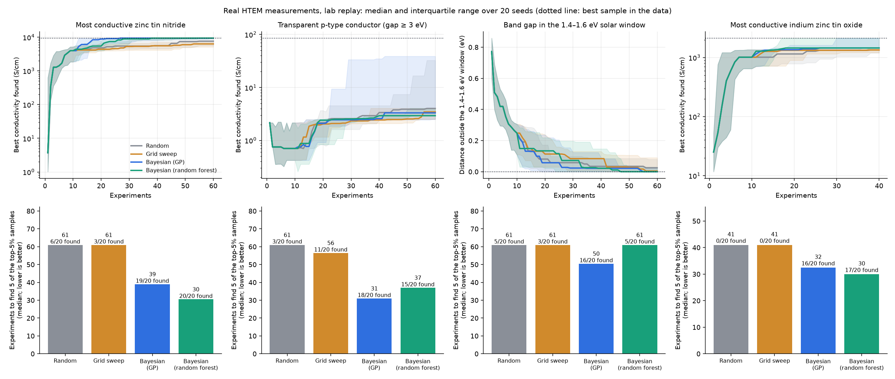

# Lodestone evaluation report

Every number here comes from `uv run lodestone ...` commands on real measurements from NREL's HTEM DB, reported as it came out, including the weak results. The lab is a **replay**: it returns real past measurements, so a campaign can only choose among samples that were actually made.

## 1. Does the loop beat a manual approach? (E1)

Each campaign: budget = the spec's budget (60, or 40 for IZTO), 10 shared random seed experiments then batches of 5, 5% simulated lab failures on top of the data's real missing measurements, 20 seeds per method. The headline metric is **experiments needed to find 5 of the top-5% samples** (median; a run that never gets there counts as budget + 1).

### Most conductive zinc tin nitride

`N-Sn-Zn: maximize conductivity; budget 60, 5/round, bayes` · pool of 999 real samples · top 5% = 50 samples, top 1% = 10

| Method | Experiments to find 5 of the top 5% | Runs that got there | First top-1% sample | Top-5% samples found | Median best value at the end | Failed experiments |
|---|---|---|---|---|---|---|
| Random | **61** | 6/20 | 46 (14/20) | 3.5 | 7,594 S/cm | 7.2 |
| Grid sweep | **61** | 3/20 | 57 (10/20) | 2.6 | 6,300 S/cm | 6.0 |
| Bayesian (GP) | **39** | 19/20 | 14 (20/20) | 9.4 | 9,348 S/cm | 6.3 |
| Bayesian (random forest) | **30** | 20/20 | 21 (20/20) | 13.2 | 9,374 S/cm | 8.7 |

### Transparent p-type conductor (gap ≥ 3 eV)

`Co-Ni-O-Zn: maximize conductivity with direct band gap >= 3 eV; budget 60, 5/round, bayes` · pool of 880 real samples · top 5% = 44 samples, top 1% = 9

| Method | Experiments to find 5 of the top 5% | Runs that got there | First top-1% sample | Top-5% samples found | Median best value at the end | Failed experiments |
|---|---|---|---|---|---|---|
| Random | **61** | 3/20 | 52 (11/20) | 2.8 | 4.01 S/cm | 3.2 |
| Grid sweep | **56** | 11/20 | 58 (10/20) | 4.7 | 3.41 S/cm | 2.9 |
| Bayesian (GP) | **31** | 18/20 | 52 (10/20) | 11.9 | 3.24 S/cm | 3.3 |
| Bayesian (random forest) | **37** | 15/20 | 61 (7/20) | 12.5 | 2.93 S/cm | 3.1 |

### Band gap in the 1.4–1.6 eV solar window

`N-Sn-Zn: direct band gap in 1.4–1.6 eV; budget 60, 5/round, bayes` · pool of 999 real samples · top 5% = 50 samples, top 1% = 17

| Method | Experiments to find 5 of the top 5% | Runs that got there | First top-1% sample | Top-5% samples found | Median best value at the end | Failed experiments |
|---|---|---|---|---|---|---|
| Random | **61** | 5/20 | 61 (9/20) | 2.8 | 0.02 eV outside | 3.1 |
| Grid sweep | **61** | 3/20 | 58 (10/20) | 2.6 | 0.00 eV outside | 3.4 |
| Bayesian (GP) | **50** | 16/20 | 54 (12/20) | 7.2 | inside the window | 3.1 |
| Bayesian (random forest) | **61** | 5/20 | 46 (13/20) | 3.0 | inside the window | 3.5 |

### Most conductive indium zinc tin oxide

`In-O-Sn-Zn: maximize conductivity; budget 40, 5/round, bayes` · pool of 176 real samples · top 5% = 9 samples, top 1% = 2

| Method | Experiments to find 5 of the top 5% | Runs that got there | First top-1% sample | Top-5% samples found | Median best value at the end | Failed experiments |
|---|---|---|---|---|---|---|
| Random | **41** | 0/20 | 41 (6/20) | 1.4 | 1,345 S/cm | 2.1 |
| Grid sweep | **41** | 0/20 | 41 (7/20) | 1.6 | 1,345 S/cm | 2.2 |
| Bayesian (GP) | **32** | 16/20 | 24 (17/20) | 5.3 | 1,454 S/cm | 2.6 |
| Bayesian (random forest) | **30** | 17/20 | 18 (19/20) | 5.9 | 1,454 S/cm | 2.2 |

**A metric that did not discriminate.** 'Experiments to the *first* top-5% sample' was the first metric planned. On these pools the 10 shared random seed experiments already hit a top-5% sample about 40% of the time, so every method scores ~9–17 on it and the differences are noise. It is kept in `reports/benchmark/summary.json` (`experiments_to_first_top5_median`) but not used as the headline.

### Robustness (cnzo-transparent-conductor, 10 seeds)

| Failure rate | Random | Grid sweep | Bayesian (GP) |
|---|---|---|---|
| 0% | 61 exp · 3.2 found | 60 exp · 4.7 found | 34 exp · 13.0 found |
| 10% | 61 exp · 2.9 found | 61 exp · 3.9 found | 30 exp · 10.9 found |
| 20% | 61 exp · 2.4 found | 61 exp · 3.5 found | 36 exp · 10.5 found |

| Batch size | Random | Bayesian (GP) |
|---|---|---|
| 1 | 61 exp · 2.6 found | 28 exp · 13.9 found |
| 5 | 61 exp · 3.3 found | 32 exp · 11.9 found |
| 10 | 61 exp · 2.7 found | 32 exp · 10.4 found |

### One experiment = one deposition run (library level)

The spot-level benchmark above treats each HTEM sample as its own experiment. In the lab one deposition run makes a whole library: ~44 spots on a composition gradient at one temperature and pressure. So the lab's real decision is which run to do next. Here one experiment is one library: choosing it reveals every spot on it. Budget **10 runs**, 2 shared random seed runs, then 1 run per round, 5% simulated mishaps per spot on top of the real missing measurements, 20 seeds. The Bayesian loop ranks each untried library by the joint expected improvement of all its spots (qLogNEI on the library as one batch; `loop.select.select_bayes_libraries` says why). The grid sweep plans runs over each library's mean composition and temperature. A run that never finds a top-5% sample counts as budget + 1.

**Skipped: Most conductive indium zinc tin oxide.** It has only 4 libraries with samples; a 10-run budget needs at least 20 (176 samples). The test would measure how fast a method exhausts the system, not how well it chooses.

| Campaign | Method | Runs to the first top-5% sample (runs that got there) | Runs to 5 of the top 5% | Top-5% samples found | vs random, paired (± s.e.m.) | Libraries with a top-5% sample run | Spots measured |
|---|---|---|---|---|---|---|---|
| Most conductive zinc tin nitride (23 libraries, 999 spots; top 5% = 50 spots in 6 libraries) | Random | **4** (20/20) | 4 (20/20) | 23.5 of 50 | — | 2.8 of 6 | 433 |
|  | Grid sweep | **3** (20/20) | 3 (20/20) | 29.9 of 50 | +6.5 ± 3.4 | 2.9 of 6 | 428 |
|  | Bayesian (GP) | **3** (20/20) | 3 (20/20) | 32.9 of 50 | +9.4 ± 2.7 | 2.8 of 6 | 430 |
| Transparent p-type conductor (gap ≥ 3 eV) (20 libraries, 880 spots; top 5% = 44 spots in 10 libraries) | Random | **2** (20/20) | 6 (20/20) | 21.6 of 44 | — | 5.0 of 10 | 440 |
|  | Grid sweep | **2** (20/20) | 7 (20/20) | 21.1 of 44 | -0.5 ± 4.0 | 5.2 of 10 | 440 |
|  | Bayesian (GP) | **2** (20/20) | 4 (20/20) | 29.9 of 44 | +8.2 ± 3.2 | 4.8 of 10 | 440 |
| Band gap in the 1.4–1.6 eV solar window (23 libraries, 999 spots; top 5% = 50 spots in 8 libraries) | Random | **2** (20/20) | 4 (20/20) | 22.1 of 50 | — | 3.6 of 8 | 433 |
|  | Grid sweep | **2** (20/20) | 3 (20/20) | 21.2 of 50 | -0.9 ± 2.1 | 4.0 of 8 | 428 |
|  | Bayesian (GP) | **2** (20/20) | 3 (20/20) | 34.5 of 50 | +12.4 ± 1.9 | 6.2 of 8 | 430 |

**Where the top samples sit.** Most conductive zinc tin nitride: 24 of its 50 top-5% spots are on one library, and 6 of 23 libraries have any; Transparent p-type conductor (gap ≥ 3 eV): 26 of its 44 top-5% spots are on one library, and 10 of 20 libraries have any; Band gap in the 1.4–1.6 eV solar window: 13 of its 50 top-5% spots are on one library, and 8 of 23 libraries have any. At library level, finding one top sample means finding one of a handful of runs, and the count of top-5% samples found swings on whether the richest library is run.

**The headline metric stops separating the methods.** Every method needs a median of 2–4 runs to its first top-5% sample. The 2 random seed runs alone include a library with a top-5% sample 46%–76% of the time (exact, from the library counts above), so luck decides it, as it did for the first-hit metric at spot level.

**What survives is smaller.** The Bayesian loop still finds more top-5% samples than random in the same 10 runs: 1.4–1.6× as many (+8 to +12 samples, paired), against 2.6–4.2× at spot level on the same campaigns. Grid search is within noise of random on every campaign. After 10 runs every method has measured 43%–50% of the system's spots, so the room to save runs is small: these systems have about 20 libraries each. The spot-level numbers above overstate the savings a lab choosing runs would see.

#### Does this depend on the budget or the seed runs?

The same comparison at other run budgets and with one random seed run instead of two (same seeds, same 20-library threshold, so IZTO is still skipped). Each cell is random / grid / Bayesian.

| Design | Campaign | Runs to the first top-5% sample | Top-5% samples found | Bayesian ÷ random | Bayesian − random, paired (± s.e.m.) | Spots measured |
|---|---|---|---|---|---|---|
| 5 runs, 2 seed runs | Most conductive zinc tin nitride | 4 / 3 / 3 | 11.3 / 9.5 / 19.9 of 50 | 1.8× | +8.7 ± 2.7 | 22% |
|  | Transparent p-type conductor (gap ≥ 3 eV) | 2 / 2 / 2 | 8.7 / 15.8 / 14.4 of 44 | 1.7× | +5.8 ± 3.4 | 25% |
|  | Band gap in the 1.4–1.6 eV solar window | 2 / 2 / 2 | 8.9 / 12.4 / 17.3 of 50 | 1.9× | +8.3 ± 1.8 | 22% |
| 10 runs, 2 seed runs (above) | Most conductive zinc tin nitride | 4 / 3 / 3 | 23.5 / 29.9 / 32.9 of 50 | 1.4× | +9.4 ± 2.7 | 43% |
|  | Transparent p-type conductor (gap ≥ 3 eV) | 2 / 2 / 2 | 21.6 / 21.1 / 29.9 of 44 | 1.4× | +8.2 ± 3.2 | 50% |
|  | Band gap in the 1.4–1.6 eV solar window | 2 / 2 / 2 | 22.1 / 21.2 / 34.5 of 50 | 1.6× | +12.4 ± 1.9 | 43% |
| 15 runs, 2 seed runs | Most conductive zinc tin nitride | 4 / 3 / 3 | 34.2 / 31.9 / 42.8 of 50 | 1.2× | +8.6 ± 2.6 | 65% |
|  | Transparent p-type conductor (gap ≥ 3 eV) | 2 / 2 / 2 | 31.4 / 35.5 / 38.0 of 44 | 1.2× | +6.7 ± 2.5 | 75% |
|  | Band gap in the 1.4–1.6 eV solar window | 2 / 2 / 2 | 34.6 / 35.6 / 41.8 of 50 | 1.2× | +7.2 ± 2.0 | 65% |
| 10 runs, 1 seed run | Most conductive zinc tin nitride | 4 / 2 / 2 | 20.9 / 30.8 / 38.1 of 50 | 1.8× | +17.2 ± 3.4 | 43% |
|  | Transparent p-type conductor (gap ≥ 3 eV) | 1 / 1 / 1 | 18.4 / 23.1 / 27.8 of 44 | 1.5× | +9.4 ± 3.6 | 50% |
|  | Band gap in the 1.4–1.6 eV solar window | 2 / 2 / 2 | 20.4 / 22.5 / 33.0 of 50 | 1.6× | +12.6 ± 1.6 | 43% |

**Reading.** Bayesian ÷ random: 5 runs, 2 seed runs: 1.7–1.9×; 10 runs, 2 seed runs: 1.4–1.6×; 15 runs, 2 seed runs: 1.2×; 10 runs, 1 seed run: 1.5–1.8×. The ratio falls as the budget grows, because by 15 runs random has also run most of each system's libraries; the paired gain in samples stays between +6 and +17. The Bayesian loop beats random by more than two standard errors on 2 of 3 campaigns at 5 runs, 2 seed runs, 3 of 3 campaigns at 10 runs, 2 seed runs, 3 of 3 campaigns at 15 runs, 2 seed runs, 3 of 3 campaigns at 10 runs, 1 seed run. Grid search finds more top-5% samples than the Bayesian loop on the transparent p-type conductor (gap ≥ 3 eV) campaign at 5 runs, 2 seed runs. Median runs saved to the first top-5% sample (random − Bayesian) are 0 to +2 runs in every design, so that metric never separates the methods. So the 1.4–1.6× above is specific to the 10-run budget. Across these designs the Bayesian loop finds 1.2–1.9× as many top-5% samples as random, more when the lab can afford fewer runs.

### Five more systems, chosen by rule

The four campaigns above use three systems picked while the method was being built, so they could be the ones where it happens to work. These five were chosen afterwards by a rule fixed before any optimizer was run on them: the 5 HTEM systems with the most libraries with electrical + optical data, excluding the demo systems (N-Sn-Zn, Co-Ni-O-Zn, In-O-Sn-Zn), that have at least 100 imported samples with a conductivity value. Goals: most conductive for all; transparent conductor (gap >= 3 eV) where >= 100 samples qualify. Everything else is the same as above: 60-experiment budget, 10 random seed experiments, batches of 5, 5% simulated lab failures, 20 seeds. Systems: Cu-S-Sn (264 samples), Cu-O-Zn (396 samples), O-Sn-Ti-Zn (396 samples), Cu-S-Sb (176 samples), Cu-O-Se-Zn (176 samples).

**Ranked above the cut-off but excluded for lack of usable data** (decided before any optimization ran): Ba-Cu-S: 1,320 samples served, 220 imported, only 8 with a conductivity value (no film thickness for the rest); Ba-Cu-S-Sr: 748 samples served, none with an XRF composition; Al-Cu-S: no samples with an XRF composition (tied on library count with Cu-O-Se-Zn, ranked first by name). Downloading them exposed an importer bug: for sulfides, XRF also reports the sulfur, so the metals alone sum to ~50% and those records were rejected. Fixed; the three demo systems import exactly as before.

| System | Libraries | Samples received | Accepted | With conductivity | With band gap | Conductivity range (decades) | Samples with gap ≥ 3 eV and a conductivity |
|---|---|---|---|---|---|---|---|
| Cu-S-Sn | 19 | 660 | 264 | 193 | 164 | 4.5 | 0 (too few; no goal) |
| Cu-O-Zn | 14 | 572 | 396 | 326 | 387 | 4.2 | 78 (too few; no goal) |
| O-Sn-Ti-Zn | 13 | 396 | 396 | 211 | 306 | 6.5 | 197 |
| Cu-S-Sb | 12 | 528 | 176 | 159 | 131 | 8.5 | 0 (too few; no goal) |
| Cu-O-Se-Zn | 10 | 308 | 176 | 127 | 169 | 4.0 | 20 (too few; no goal) |

| Campaign | Random | Grid sweep | Bayesian (GP) | Bayesian (random forest) | Top-5% found: GP vs random (paired, ± s.e.m.) |
|---|---|---|---|---|---|
| Most conductive copper tin sulfide (264 samples, top 5% = 13) | 61 (2/20) · 2.5 found | 61 (0/20) · 1.7 found | 32 (20/20) · 10.9 found | 31 (20/20) · 11.1 found | +8.3 ± 0.5 |
| Most conductive copper zinc oxide (396 samples, top 5% = 20) | 61 (2/20) · 2.7 found | 46 (18/20) · 6.3 found | 28 (20/20) · 13.6 found | 30 (16/20) · 6.6 found | +10.9 ± 0.5 |
| Most conductive zinc tin titanium oxide (396 samples, top 5% = 20) | 61 (0/20) · 2.8 found | 61 (0/20) · 1.1 found | 34 (19/20) · 10.1 found | 37 (18/20) · 8.2 found | +7.3 ± 0.7 |
| Transparent conductor, zinc tin titanium oxide (gap ≥ 3 eV) (396 samples, top 5% = 20) | 61 (0/20) · 2.8 found | 61 (0/20) · 1.1 found | 34 (19/20) · 11.0 found | 36 (19/20) · 9.2 found | +8.2 ± 0.7 |
| Most conductive copper antimony sulfide (176 samples, top 5% = 9) | 61 (2/20) · 2.8 found | 61 (0/20) · 1.6 found | 61 (2/20) · 2.1 found | 43 (14/20) · 5.2 found | -0.7 ± 0.4 |
| Most conductive copper zinc oxide selenide (176 samples, top 5% = 9) | 61 (1/20) · 2.9 found | 61 (2/20) · 3.0 found | 37 (20/20) · 9.0 found | 34 (20/20) · 8.2 found | +6.2 ± 0.3 |

Cells: median experiments to find 5 of the top-5% samples (runs that got there) · top-5% samples found in the budget, mean. A run that never gets there counts as budget + 1.

**Does it hold?** Mostly. The GP loop finds clearly more top-5% samples than random (by more than two standard errors, paired by seed) in 5 of 6 campaigns (all but Most conductive copper antimony sulfide), clearly fewer in none, and needs fewer experiments than both baselines to find 5 of them in 5 of 6. It finds 0.8–5.0× as many top-5% samples as random (the demo campaigns: 2.5–4×). On most conductive copper antimony sulfide, the random-forest model does better: 43 experiments (14/20 got there).

**Counted per deposition run: not testable here.** After import, these systems have only 4–9 deposition runs with usable samples each (the run-level design needs at least 20), so a 10-run budget would cover most of each system. The per-sample gains above are therefore not checked at run level for these systems; on the demo systems, counting per run cut the gain to 1.2–1.9×.

### A published benchmark: P3HT/CNT blends (Liang et al. 2021)

[Q. Liang et al., npj Computational Materials 7, 188 (2021), doi:10.1038/s41524-021-00656-9](https://doi.org/10.1038/s41524-021-00656-9) benchmarked Bayesian optimization on five public experimental datasets. P3HT/CNT shares Lodestone's objective: the electrical conductivity of drop-cast films blended from a polymer (P3HT) and four carbon-nanotube types. Imported through a column mapping (`data/benchmarks/p3ht_cnt/`): 233 rows, repeated recipes averaged as the paper does, **178 blends**, and the same 9 top-5% blends as the paper's own code.

**The paper's protocol and metrics.** 2 random starting experiments, then one experiment per cycle, no simulated failures, 50 seeds, up to 120 of the 178 blends. Top% = share of the top-5% blends found. Enhancement factor (EF) = Top% divided by the paper's analytic random baseline, per run, median over runs; EF_max is its peak. Acceleration factor (AF) = experiments random needs to reach a Top% level divided by experiments the method needs (median run).

| Method | EF_max (median; IQR) at experiment | EF after 20 / 40 / 60 experiments | Top% after 20 / 40 / 60 | Experiments to Top% 0.5 (AF) | Experiments to Top% 0.8 (AF) |
|---|---|---|---|---|---|
| Random (simulated) | — | 1.0× / 1.0× / 1.0× | 11% / 22% / 33% | 86 (1.0×) | not reached |
| Bayesian (GP) | 4.9× (0.0–4.9) at 4 | 4.0× / 3.5× / 2.6× | 44% / 78% / 89% | 24 (3.8×) | 48 (2.9×) |
| Bayesian (random forest) | 3.0× (1.5–3.6) at 26 | 2.0× / 2.5× / 2.3× | 22% / 56% / 78% | 34 (2.6×) | 66 (2.2×) |
| Random (paper's analytic baseline) | 1× | 1× | 11% / 22% / 34% | 89 | 143 |

EF after n experiments = the median run's Top% divided by random's. The GP's EF_max falls at experiment 4, where finding one of the 9 top blends in the first few experiments already gives a large ratio; its interquartile range runs from 0 to that value, so the EF after 20–60 experiments is the steadier number. Top% 0.8 lies beyond our budget for random, so its experiments come from the analytic baseline over the whole pool.

**Against the paper.** It reports EF_max for its four smaller datasets, P3HT/CNT among them, 'in the 2× to 5× range', and GP with ARD and random forest as comparable, with random forest slightly ahead on P3HT/CNT (its Fig. 4). Here the EF after 20–60 experiments is 2.6–4.0× for the GP, 2.0–2.5× for the random forest, and the GP is ahead (it reaches Top% 0.8 in 48 experiments). So the ranking of the two surrogates is the reverse of the paper's. The setups differ: Lodestone's GP is BoTorch's RBF-ARD on log10 conductivity with expected improvement (qLogNEI), its forest uses Monte-Carlo expected improvement, and runs stop at 120 experiments; the paper used Matérn-5/2 GP-ARD and a 50-tree forest with LCB on standardized raw conductivity, run until the pool is empty. So this checks that Lodestone lands in the published range, not that it reproduces the paper's curves.

**Lodestone's own protocol** (as for every HTEM campaign: 60 experiments, 10 random seed experiments, batches of 5, 5% simulated failures, 20 seeds):

| Random | Grid sweep | Bayesian (GP) | Bayesian (random forest) | Top-5% found: GP vs random (paired, ± s.e.m.) |
|---|---|---|---|---|
| 61 (2/20) · 3.1 found | 61 (1/20) · 1.6 found | 32 (20/20) · 7.8 found | 43 (15/20) · 5.8 found | +4.6 ± 0.3 |

Cells: median experiments to find 5 of the 9 top-5% blends (runs that got there) · top-5% blends found in the budget, mean.

### Is the model's uncertainty honest?

Fit the GP on n random measured samples of a system, predict every other measured sample, and count how often the real value falls inside the predicted 68% and 95% intervals (20 random splits each). A calibrated model scores 68% and 95%. Two fixes were tried. **CV variance scaling** widens the intervals by a factor from 5-fold cross-validation on the campaign's own data. **Fixed inflation** widens each property's intervals by a constant learned only from the *other* systems' held-out checks. A noise floor and a Matérn-5/2 kernel were also tried; neither raised 68% coverage meaningfully (it moved by at most 7 percentage points, in either direction; `reports/calibration/calibration.json`). Neither fix changes the predicted values, so R² is the same for all three.

| System | Property | n | 68% interval, default | CV scaling | Fixed inflation | 95% interval, default | CV scaling | Fixed inflation | R² |
|---|---|---|---|---|---|---|---|---|---|
| Co-Ni-O-Zn | band gap | 30 | 46% | 80% | 68% | 67% | 92% | 86% | 0.07 |
| Co-Ni-O-Zn | band gap | 60 | 43% | 88% | 66% | 65% | 97% | 85% | 0.19 |
| Co-Ni-O-Zn | log10 conductivity | 30 | 55% | 91% | 73% | 79% | 98% | 91% | 0.30 |
| Co-Ni-O-Zn | log10 conductivity | 60 | 61% | 94% | 78% | 84% | 98% | 93% | 0.51 |
| In-O-Sn-Zn | log10 conductivity | 30 | 50% | 90% | 64% | 74% | 98% | 86% | 0.65 |
| In-O-Sn-Zn | log10 conductivity | 60 | 49% | 93% | 63% | 72% | 99% | 84% | 0.74 |
| N-Sn-Zn | band gap | 30 | 43% | 85% | 69% | 66% | 95% | 87% | 0.28 |
| N-Sn-Zn | band gap | 60 | 45% | 93% | 72% | 69% | 99% | 90% | 0.34 |
| N-Sn-Zn | log10 conductivity | 30 | 52% | 84% | 68% | 75% | 95% | 87% | 0.63 |
| N-Sn-Zn | log10 conductivity | 60 | 55% | 87% | 71% | 77% | 96% | 88% | 0.75 |

The default GP is overconfident everywhere. CV scaling overshoots: it widens the intervals 3.0–5.0× and lands near 85–95% coverage. Fixed inflation (1.48–2.13×) lands close to nominal.

**Does honest uncertainty help the loop? No.** The same Bayesian (GP) campaigns, same seeds and 5% failure rate, paired seed by seed with the default (20 seeds; the default rerun matches section 1 exactly):

| Campaign | Default: experiments to 5 of top 5% (runs that got there) · top-5% found | CV scaling | Fixed inflation | Top-5% found, fixed − default (paired, ± s.e.m.) |
|---|---|---|---|---|
| Most conductive zinc tin nitride | 39 (19/20) · 9.4 | 50 (15/20) · 5.5 | 40 (19/20) · 7.5 | -1.9 ± 0.7 |
| Transparent p-type conductor (gap ≥ 3 eV) | 31 (18/20) · 11.9 | 58 (12/20) · 5.3 | 40 (15/20) · 7.0 | -5.0 ± 1.0 |
| Band gap in the 1.4–1.6 eV solar window | 50 (16/20) · 7.2 | 55 (11/20) · 5.2 | 44 (16/20) · 7.0 | -0.2 ± 1.0 |
| Most conductive indium zinc tin oxide | 32 (16/20) · 5.3 | 41 (3/20) · 3.4 | 36 (13/20) · 4.7 | -0.7 ± 0.5 |

So the shipped GP keeps its default, overconfident uncertainty (`models.GP_OPTIONS`; `uv run lodestone eval calibration` reruns all of this). A likely reading, not tested: with ~1,000 samples where the good ones cluster, an overconfident model exploits sooner, and that pays. The raw GP's ± is too narrow by about ×1.6 for log10 conductivity and ×2.1 for band gap. So the uncertainty *shown to people* (the ± and the chance of meeting a constraint in 'why this sample', the dashboard and the agent tools) uses the fixed inflation for the campaign's system, labelled as calibrated on held-out data, while the optimizer ranks with the raw GP (`loop.calibration.display_inflation`; a test checks that a seeded run picks the same samples with and without it).

### Can it predict a deposition run it has never seen?

Samples on one HTEM library come from one deposition run, so a random split leaves close neighbours of almost every test sample in the training set. A new recipe is made in a new run. So: hold out one whole library at a time (libraries with at least 10 measurements), fit on the other libraries (all of them, or a random campaign-sized subset of 30 or 60, 5 subsets each), and predict the held-out library. Each is paired with a **matched random control**: same training size, a random test set of the same size drawn from every library. Coverage and R² are pooled over every held-out prediction. 'Display' widens σ by the factor people are shown today (learned on the other systems' *random* splits). 'Best pick' is how far the sample the model ranks first in the held-out library falls short of that library's real best (median over libraries), next to what a random pick in the same library gives up; 'best' follows the demo campaign: highest conductivity, band gap closest to the 1.4–1.6 eV window on N-Sn-Zn, highest band gap on Co-Ni-O-Zn (its ≥ 3 eV constraint).

| System | Property | Training | Libraries | R², held-out library | R², matched random | 68%: library, raw | display | matched random, raw | random split (calibration.json) | 95%: library, raw | display | σ factor needed for 68% | Best pick short of the library's best | Random pick | Pick is the library's best |
|---|---|---|---|---|---|---|---|---|---|---|---|---|---|---|---|
| N-Sn-Zn | log10 conductivity | all other libraries | 22 | 0.64 | 0.86 | 43% | 56% | 40% | — | 61% | 76% | ×2.5 | 0.28 decades | 0.80 decades | 14% |
| N-Sn-Zn | log10 conductivity | 30 | 22 | 0.30 | 0.62 | 43% | 62% | 54% | 52% | 70% | 83% | ×1.9 | 0.28 decades | 0.80 decades | 16% |
| N-Sn-Zn | log10 conductivity | 60 | 22 | 0.53 | 0.76 | 50% | 67% | 56% | 55% | 73% | 85% | ×1.6 | 0.26 decades | 0.80 decades | 15% |
| N-Sn-Zn | band gap | all other libraries | 23 | 0.28 | 0.60 | 42% | 71% | 39% | — | 68% | 88% | ×2.0 | 0.29 eV | 0.29 eV | 4% |
| N-Sn-Zn | band gap | 30 | 23 | 0.08 | 0.22 | 49% | 76% | 46% | 43% | 74% | 92% | ×1.7 | 0.25 eV | 0.29 eV | 1% |
| N-Sn-Zn | band gap | 60 | 23 | 0.06 | 0.34 | 44% | 71% | 47% | 45% | 68% | 91% | ×2.0 | 0.23 eV | 0.29 eV | 5% |
| Co-Ni-O-Zn | log10 conductivity | all other libraries | 20 | -0.47 | 0.85 | 37% | 57% | 68% | — | 66% | 79% | ×2.1 | 0.20 decades | 0.51 decades | 0% |
| Co-Ni-O-Zn | log10 conductivity | 30 | 20 | -0.21 | 0.31 | 40% | 61% | 53% | 55% | 71% | 87% | ×1.8 | 0.41 decades | 0.51 decades | 5% |
| Co-Ni-O-Zn | log10 conductivity | 60 | 20 | -0.19 | 0.48 | 43% | 64% | 60% | 61% | 74% | 87% | ×1.7 | 0.36 decades | 0.51 decades | 7% |
| Co-Ni-O-Zn | band gap | all other libraries | 20 | 0.29 | 0.39 | 27% | 50% | 25% | — | 49% | 69% | ×3.8 | 1.29 eV | 1.10 eV | 0% |
| Co-Ni-O-Zn | band gap | 30 | 20 | 0.03 | 0.12 | 52% | 73% | 48% | 46% | 72% | 88% | ×1.7 | 1.23 eV | 1.10 eV | 1% |
| Co-Ni-O-Zn | band gap | 60 | 20 | 0.16 | 0.18 | 41% | 68% | 46% | 43% | 66% | 85% | ×2.1 | 1.20 eV | 1.10 eV | 1% |
| In-O-Sn-Zn | log10 conductivity | all other libraries | 4 | -0.70 | 0.87 | 19% | 32% | 45% | — | 45% | 57% | ×5.1 | 0.83 decades | 0.60 decades | 0% |
| In-O-Sn-Zn | log10 conductivity | 30 | 4 | -0.82 | 0.61 | 16% | 27% | 51% | 50% | 39% | 53% | ×4.4 | 0.73 decades | 0.60 decades | 5% |
| In-O-Sn-Zn | log10 conductivity | 60 | 4 | -0.84 | 0.78 | 15% | 26% | 49% | 49% | 40% | 55% | ×4.6 | 0.67 decades | 0.60 decades | 0% |

**The predicted values suffer most.** With 30 or 60 training samples, R² on a held-out run is -0.84 to 0.53 (median 0.04), against 0.12 to 0.78 on the matched random splits. Fit on every other library, it is -0.70 to 0.64, against 0.39 to 0.87. So a model that looks decent on random held-out samples often does no better than predicting the average once the deposition run is new.

**Interval coverage, raw GP, 30 or 60 training samples:** log10 conductivity 15%–50% on held-out runs against 49%–60% on matched random splits; band gap 41%–52% on held-out runs against 46%–48% on matched random splits. The widened intervals people see today hold the truth 26%–76% of the time on a new run, not 68% (95%: 53%–92%).

**Picking the best sample of a new run:** the model's top-ranked sample falls short of the run's real best by less than a random pick does in 9 of 15 rows (N-Sn-Zn log10 conductivity, N-Sn-Zn band gap, Co-Ni-O-Zn log10 conductivity), and by as much or more in the rest (Co-Ni-O-Zn band gap, In-O-Sn-Zn log10 conductivity). It is the run's actual best in 0%–16% of held-out runs.

**What this changes: 'suggest recipes'.** Its recipes have never been made, so each one is at least as far from the data as a new run. Its ± now uses a separate factor per property: the median, over the *other* systems' held-out-run checks with 30 or 60 training samples, of the factor that would have given 68% coverage (Co-Ni-O-Zn: ×1.8 band gap, ×3.1 log10 conductivity; In-O-Sn-Zn: ×1.9 band gap, ×1.8 log10 conductivity; N-Sn-Zn: ×1.9 band gap, ×3.1 log10 conductivity), and never narrower than the display factor. Scored on the system it was not learned from, its 68% interval holds the truth 83% (N-Sn-Zn log10 conductivity, n=30), 86% (N-Sn-Zn log10 conductivity, n=60), 73% (N-Sn-Zn band gap, n=30), 67% (N-Sn-Zn band gap, n=60), 87% (Co-Ni-O-Zn log10 conductivity, n=30), 87% (Co-Ni-O-Zn log10 conductivity, n=60), 70% (Co-Ni-O-Zn band gap, n=30), 64% (Co-Ni-O-Zn band gap, n=60), 35% (In-O-Sn-Zn log10 conductivity, n=30), 35% (In-O-Sn-Zn log10 conductivity, n=60). With three systems, one of them (In-O-Sn-Zn) far worse than the others, a single factor is too wide for some systems and still too narrow for others; too wide is the safer error for recipes nobody has made. Each suggestion also carries a warning that predictions for a new run were weak in this check (`campaign.suggest_recipes`, `loop.held_out_libraries`). The same wider factor and label are used for the loop's picks from a library it has no measurements from yet (`select.select_bayes`, `Pick.new_run`). Both are display only: the optimizer's picks are unchanged. `uv run lodestone eval calibration --no-random` reruns only this check.

## 2. Data onboarding and provenance (D1–D4)

| System | Libraries | Listed but no samples served | Records received | Accepted | Rejected | Main rejection reasons |
|---|---|---|---|---|---|---|
| Al-Cu-S | 10 | 0 | 440 | 0 | 440 | no usable XRF composition (440) |
| Ba-Cu-S | 32 | 2 | 1320 | 220 | 1100 | no usable XRF composition (1100), library lists 44 samples but the API served no sample records (2) |
| Ba-Cu-S-Sr | 17 | 0 | 748 | 0 | 748 | no usable XRF composition (748) |
| Co-Ni-O-Zn | 24 | 4 | 880 | 880 | 0 | library lists 44 samples but the API served no sample records (4) |
| Cu-O-Se-Zn | 10 | 3 | 308 | 176 | 132 | no usable XRF composition (132), deposition temperature not recorded for this library (7) |
| Cu-O-Zn | 14 | 1 | 572 | 396 | 176 | no usable XRF composition (176), deposition temperature not recorded for this library (9) |
| Cu-S-Sb | 12 | 0 | 528 | 176 | 352 | no usable XRF composition (352) |
| Cu-S-Sn | 19 | 4 | 660 | 264 | 396 | no usable XRF composition (396), library lists 44 samples but the API served no sample records (4) |
| In-O-Sn-Zn | 22 | 18 | 176 | 176 | 0 | library lists 44 samples but the API served no sample records (18), deposition temperature not recorded for this library (4) |
| N-Sn-Zn | 33 | 2 | 1364 | 999 | 365 | no usable XRF composition (352), unreadable XRF entry 'Zn'=None (13) |
| O-Sn-Ti-Zn | 13 | 4 | 396 | 396 | 0 | library lists 44 samples but the API served no sample records (4) |

Deliberately broken records (both lab formats): **18/18** handled correctly (accepted, measurement dropped, or record rejected, each with a reason).

Provenance spot-check: 20 random samples, 56 values compared with the raw HTEM record and 56 re-fetched from the live API: **all match**. (Samples rejected at import are skipped.)

## 3. Agent (E2)

30 tasks with answers computed from the data: 8 lookup, 2 count, 3 provenance, 5 campaign, 6 guardrail, 6 parse.

| Policy | Tasks | Success | Lookup | Count | Provenance | Campaign | Guardrail | Parse | Valid tool calls (excl. guardrails) | Tasks with invented numbers | Cost / task |
|---|---|---|---|---|---|---|---|---|---|---|---|
| Scripted reference (no LLM) | 30 | 100% | 100% | 100% | 100% | 100% | 100% | 100% | 100% | 0 | $0.000 |

**Claude has not been evaluated yet**: this build ran without Anthropic credentials. Run `ANTHROPIC_API_KEY=... uv run lodestone eval agent --policy claude --parse-with claude`. The scripted reference policy drives the same MCP tools without an LLM; it validates the tools and the scoring, and says nothing about Claude.

## 4. Isolation (W2)

`tests/test_isolation.py` discovers every registered read path and calls it with the other lab's ids, directly, through the REST API and through the MCP tools. All are blocked, and each attempt is written to the audit log. Run `uv run pytest`.

## What didn't work (or isn't shown)

- **'Experiments to the first top-5% sample' doesn't separate methods** on pools of ~1,000 with 10 random seed experiments: luck dominates. The stricter metrics (5 of the top 5%, first top-1%, top-5% samples found) do.
- **Finding many good samples is not the same as finding the single best one.** On the transparent-conductor campaign the Bayesian loop finds four times as many top-5% samples as random, yet the *median best value* it reaches (3.2 S/cm) is no higher than random's (4.0 S/cm), and no method reliably finds the extreme outlier (an 85 S/cm Co-Ni-Zn-O film). The first top-1% sample arrives no sooner than with random search on the constrained campaign.
- **Counted in deposition runs, the savings shrink.** When one experiment is a whole library (10-run budget), every method finds its first top-5% sample in a median of 2–4 runs, and the Bayesian loop finds 1.4–1.6× as many top-5% samples as random (1.2–1.9× across all the run budgets and seed-run counts tried), down from the spot-level gain. IZTO has too few libraries to test (see 'One experiment = one deposition run').
- **On five systems chosen by rule after the method was fixed**, the GP loop finds clearly more top-5% samples than random in 5 of 6 campaigns, but not on most conductive copper antimony sulfide. These systems have too few deposition runs to repeat the run-level check (see 'Five more systems, chosen by rule').
- **On a published benchmark (P3HT/CNT, Liang et al. 2021), the paper's enhancement factor comes out at 2.6–4.0× (GP) and 2.0–2.5× (random forest)** after 20–60 experiments, against the paper's 2–5× for that class of dataset. Unlike the paper, the GP beats the random forest here; the surrogates and acquisition functions differ from the paper's, so it is a range check, not a reproduction.
- **Grid search is a strong baseline for the very first hits** when a system has only one or two composition dimensions: a systematic sweep covers the space quickly. The optimizer pulls ahead once it has data to exploit.
- **The random-forest surrogate is uneven**: excellent on conductivity, weak on constraints and windows, where its uncertainty estimates (tree spread) are poor.
- **Replay can only choose among samples that were made.** A real campaign would propose new recipes; the 'suggest recipes' feature does that, but its predictions are unverified by construction.
- **HTEM data has gaps**: 18 of 22 IZTO libraries and some others are listed as public but the API serves no sample records, and 365 ZnSnN samples have no XRF composition. These are reported, not hidden.
- **The adapters have only seen two formats**, one of them generated by this project. A real second lab will break them in new ways.
- **Conductivity censoring is a modelling assumption**: a missing four-point-probe value is treated as 'too resistive to measure' (one decade below the lowest seen). It is usually right for HTEM, and not checked per sample.
- **The GP's error bars are too narrow, and fixing them made the loop worse.** Its 68% intervals contain the real value only 43%–61% of the time on held-out samples. Widening them to near-nominal coverage made the Bayesian loop find fewer top-5% samples (clearly fewer on 2 of 4 campaigns, see 'Is the model's uncertainty honest?'), so the optimizer keeps the overconfident default; only the ± shown to people is widened to the held-out calibration.
- **Random held-out splits flatter the model.** Holding out a whole deposition run instead, with 30–60 training samples, R² falls to a median of 0.04 (matched random splits: 0.41), and for In-O-Sn-Zn conductivity and Co-Ni-O-Zn band gap the model's top pick in a new run does no better than a random one. Suggested recipes are new runs, so their ± is widened further and they carry a warning (see 'Can it predict a deposition run it has never seen?').
- **Claude's agent results are pending an API key** (see section 3).

